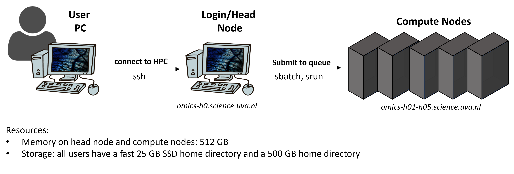

## Using an HPC

::: callout-tip
New to HPCs? The [Getting started with bash and an HPC](https://ndombrowski.github.io/cli_workshop/) tutorial explains step by step how to log in to Crunchomics, copy your data there and run your first jobs. These pages are a reference.
:::

On the next pages you find documentation on working with an **HPC** (high-performance computer): a group of powerful computers that many people share. These pages are tailored towards researchers at the UvA, but most of it also applies to other HPCs that use the SLURM job scheduler.

### Getting access to Crunchomics

Crunchomics is the Genomics Compute Environment for SILS and IBED. For how to get an account, and for the full documentation of the cluster, see the [Crunchomics documentation](https://crunchomics-documentation.readthedocs.io/en/latest/).

For other computational resources, see the [website of the IBED computational support team](https://ibed.uva.nl/facilities/computational-facilities/ibed-computational-support-team/ibed-computational-support-team.html) under **Scientific programming and HPC**.

### How does an HPC work?

Working on an HPC is a bit different from working on your own computer. The figure below gives a simplified overview:

{width=70% fig-align="center"}

-   You log in from your own computer with `ssh`.
-   When you log in, you arrive on the **login node**, also called the **head node**. This computer is for preparing your work, for example moving and editing files and writing job scripts. It is not for running analyses.
-   The analyses run on the **compute nodes**. These computers have many more CPUs and much more memory.
    -   A **CPU** is what does the calculations, so more CPUs means more work can get done at the same time.
    -   **Memory (RAM)** is the working space a program uses while it runs. Memory is not the same as storage, which is where your files are kept.
-   In between is **SLURM**, a **workload manager** (also called a **scheduler**) that is used on many large HPCs. You send your analysis to SLURM as a **job**, and SLURM runs it on a compute node. SLURM does three things:
    -   It gives users access to CPUs and memory on the compute nodes, for a limited time
    -   It starts and runs the jobs, and lets you check on them
    -   It manages the **queue**: the list of jobs that wait until enough CPUs and memory are free

### Crunchomics etiquette

::: callout-important
You share Crunchomics with many other people, so only ask for the resources that you actually use. There are no hard limits, but please follow these rules:

-   Do NOT run jobs that need many CPUs or a lot of memory on the login node (`omics-h0`). Use the compute nodes (`omics-cn001` to `omics-cn005`) for this
-   Do NOT use more than 20% of the CPUs or memory of the cluster for more than a day. If you have large jobs, contact the Crunchomics team (see the [Crunchomics documentation](https://crunchomics-documentation.readthedocs.io/en/latest/))
-   Don't leave resources that you reserved unused, and set reasonable time limits on your jobs
-   Use the queue (SLURM) for large jobs. Working interactively is possible, but not for large jobs. See [Start working on an HPC](slurm_basics.qmd) for how to use the queue
-   Close programs when you don't use them anymore, for example an R session
:::

### Storage

On Crunchomics, you have two folders (`$USER` stands for your user name):

-   Your **home directory**, `/home/$USER`, with 25 GB of space
-   Your **personal directory**, `/zfs/omics/personal/$USER`, with 500 GB of space. Since this directory is larger, run your analyses and install your software here. After the [first-time setup](slurm_basics.qmd#setup-for-first-time-crunchomics-users), you reach it with the shortcut `~/personal`

Good to know:

-   Your data is removed from Crunchomics after the duration of your grant, or when your UvAnetID expires
-   If you need more space, or a shared folder for a larger project with several team members, contact the Crunchomics team
-   **Snapshots:** Crunchomics automatically makes **snapshots**, saved copies of your files. It makes one every hour, which is kept for 24 hours, and one every day around midnight, which is kept for a week. So if you delete a file by mistake, you can still get it back for up to a week. You can look at the snapshots and read the files in them in the hidden `.zfs/snapshot` folder, for example with `ls /zfs/omics/personal/$USER/.zfs/snapshot`. But snapshots also mean that files you delete still count towards your storage limit until the last snapshot with them is removed. Keep this in mind if you make many or large temporary files. If you need a file restored, or snapshots removed to free up space, contact the Crunchomics team
-   Your data is stored on several disks, which protects it if one disk breaks. But it is not copied anywhere else. **Crunchomics is not a backup or an archive.** You are responsible for backing up your own data. For archiving options at the UvA, see the [website of the IBED computational support team](https://ibed.uva.nl/facilities/computational-facilities/ibed-computational-support-team/ibed-computational-support-team.html) and [Using the IBED Tape Archive](ibed_tape.qmd)
-   For large temporary files, each compute node also has its own fast local storage, see [Using scratch on Crunchomics](scratch.qmd)

### Compute resources

-   Crunchomics has 5 compute nodes, each with 64 CPUs and 512 GB of memory
-   If you need more resources, or GPUs, see the [website of the IBED computational support team](https://ibed.uva.nl/facilities/computational-facilities/ibed-computational-support-team/ibed-computational-support-team.html)
